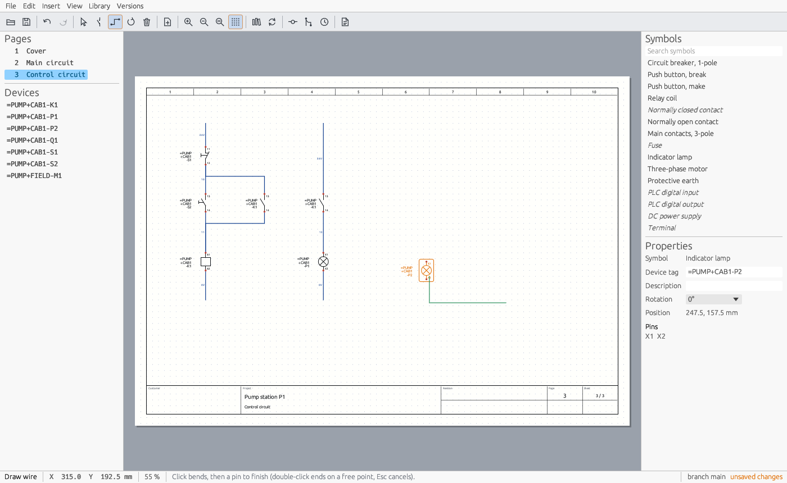

# WiringCraft

An open, original electrical schematic and wiring design tool written in Rust.

WiringCraft covers the familiar workflow of electrical CAD (schematic pages, symbols, device tags,
wires and potentials, terminal strips, cables and reports) and rebuilds the plumbing underneath it:

- **Projects are plain text.** One file per page, sorted keys, written atomically and only when
  changed. Diff, merge and review them in git like code.
- **The library is versioned.** Every symbol and part has a content hash; a project pins the exact
  versions it uses in `library.lock` and keeps a copy in `vendor/`, so it opens offline and never
  changes underneath you. Updates are shown as a before/after list you accept item by item.
- **Everything is scriptable** through the `wiringcraft` command line.

## Status

Phase 1 (foundation) is in progress: project format, library and sync, imports, PDF export.
See the feature list for the full plan.

## Layout

| Crate | Role |
|---|---|
| `wc-core` | data model, device tags (IEC 81346 style), project folder format, connectivity |
| `wc-library` | library sources, lockfile, vendoring, update status |
| `wc-import` | DXF, SVG, CSV, AutomationML, PDF trace, Eplan P8 projects, SolidWorks Electrical projects (.tewzip) and project archive import |
| `wc-report` | parts list, device list, wire list, net list, terminal plan, cable list, PLC I/O list, table of contents |
| `wc-pdf` | vector PDF export (schematic pages plus report pages) |
| `wc-vcs` | git versioning, subway-map history, schematic change lists |
| `wc-agent` | the live AI assistant: Claude Code connection (your login), tool bridge, API client |
| `wc-share` | shared work sessions: join approval, page locks, one commit per change (app and network to follow) |
| `wc-cli` | the `wiringcraft` command |
| `wc-app` | the desktop editor (`wiringcraft-app`) |

## Desktop app

```sh
cargo run -p wc-app -- path/to/project
```

Pages on the left, the sheet in the middle, the symbol library and properties on the right.
Commands sit in classic menus and icon toolbars by default; View → Layout switches to a ribbon
(the choice is saved). Both show the same commands from one registry. View → Dark mode (or the
half-moon button at the right end of the toolbar) switches between the light and dark interface;
the sheet stays paper-white in both. The interface font is Inter (SIL Open Font License, bundled
in `crates/wc-app/assets/fonts`).

| Classic toolbars (default) | Ribbon (optional) |
|---|---|
|  |  |


Tools: select and drag (Esc), place symbol (S, pick one in the library), draw wire (W: click a
pin, click bends, click a pin to finish or double-click a free point), rotate (R), delete (Del).
Wheel zooms around the pointer, right or middle drag pans, F fits the page, G toggles the grid.
New devices get the next free tag, with the function and location used on that page.
Versions → Commit / Branch / History records versions and shows the subway map.

### Assistant

View → Assistant (Ctrl+J, or the speech-bubble button at the end of the toolbar) opens a panel
where you tell Claude what to draw or change in plain words. It works in the open project while
you watch: places symbols, draws wires, edits pages, devices, parts, panel layouts and comments,
runs checks, reports and exports, records versions, and can run any toolbar command and any
`wiringcraft` command-line command (imports, PLC variable lists, STEP export, merges ...).
Everything it changes in one turn is a single undo step (Ctrl+Z).

By default it uses your own Claude login, the same way as SolidCraft: WiringCraft starts
Claude Code through its connector and hands it the WiringCraft tools, so the chat runs on your
Claude plan and no API key is needed. One-time setup:

```sh
npm install -g @agentclientprotocol/claude-agent-acp   # the Claude Code connector
claude                                                 # then /login once
```

Claude Code only gets WiringCraft's tools in this chat (no shell, file or web tools), and it
reaches them through a local port only this computer can use, with a fresh token each run. It
starts in WiringCraft's own settings folder, never in the project folder, so settings inside
a project you were sent cannot run anything when the assistant starts.

To use an Anthropic API key instead, choose **API key** under Settings in the panel, then paste
the key there or set `ANTHROPIC_API_KEY` (setting the variable alone does not switch). A pasted
key is kept in your WiringCraft preferences, never in a project.
Settings also pick the model and the effort. The connections are in `crates/wc-agent`
(`acp.rs` for Claude Code, `bridge.rs` for the tool bridge); the tools are in
`crates/wc-app/src/agent.rs`.


## Build

```sh
cargo test --workspace
cargo run -p wc-cli -- --help
```

## Rules

- Original work only: no code, symbols, icons, templates or branding copied from other products.
- No panics on user input: no `unwrap`/`expect`/`panic!` outside tests (enforced by clippy lints).
- Every change is a pull request; work comes from the todo list and is claimed first. See [CONTRIBUTING.md](CONTRIBUTING.md).

## Licence and disclaimer

MIT OR Apache-2.0, at your option: [LICENSE-MIT](LICENSE-MIT), [LICENSE-APACHE](LICENSE-APACHE). WiringCraft is
provided as is, without warranty; check its output before building anything, and read
[DISCLAIMER.md](DISCLAIMER.md) on safety, harmful or unlawful use, and imported data.
