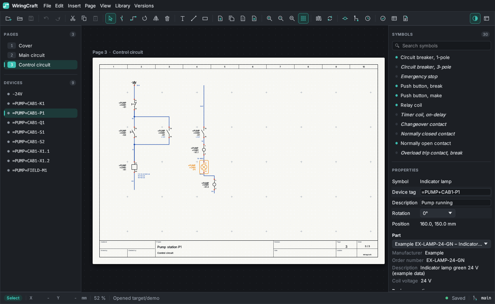
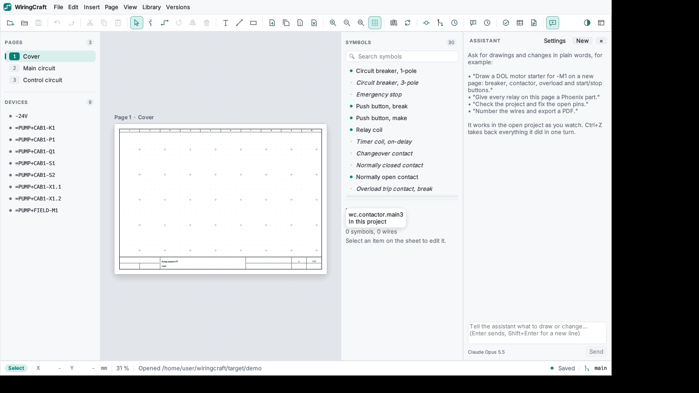

# WiringCraft

An open, original electrical schematic and wiring design tool written in Rust.

WiringCraft covers the familiar workflow of electrical CAD (schematic pages, symbols, device tags,
wires and potentials, terminal strips, cables and reports) and rebuilds the plumbing underneath it:

- **Projects are plain text.** One file per page, sorted keys, written atomically and only when
  changed. Diff, merge and review them in git like code.
- **The library is versioned.** Every symbol and part has a content hash; a project pins the exact
  versions it uses in `library.lock` and keeps a copy in `vendor/`, so it opens offline and never
  changes underneath you. Updates are shown as a before/after list you accept item by item.
- **Everything is scriptable** through the `wiringcraft` command line.

## Status

Phase 1 (foundation) is in progress: project format, library and sync, imports, PDF export.
See the feature list for the full plan.

## Layout

| Crate | Role |
|---|---|
| `wc-core` | data model, device tags (IEC 81346 style), project folder format, connectivity |
| `wc-library` | library sources, lockfile, vendoring, update status |
| `wc-import` | symbols from DXF, SVG, KiCad symbol libraries and QElectroTech elements; parts from CSV, Excel (.xlsx), BMEcat catalogues and EDZ files (with their macros as symbols); PLC address lists; WAGO configurator lists; maker footprint DXFs and STEP model sizes; pages from DXF, DWG and PDF (trace); AutomationML, Eplan P8 and SolidWorks Electrical projects and libraries (.tewzip); open-format parts of project archives |
| `wc-report` | parts list, device list, wire list, net list, terminal plan, cable list, PLC I/O list, PLC card overview, location list, network list, table of contents; project check; PLC variable lists, WAGO marker and configurator lists, AutomationML and STEP panel exports |
| `wc-pdf` | vector PDF export: schematic pages, report tables, panel layouts, PLC card sheets and network topology sheets; schematic pages and panel layouts also as SVG and DXF |
| `wc-vcs` | git versioning, subway-map history, schematic change lists |
| `wc-agent` | the live AI assistant: Claude Code connection (your login), tool bridge, API client |
| `wc-share` | shared work sessions: join approval, page locks, one commit per change, TCP transport, network discovery; used by the app's Share session and Join session |
| `wc-cli` | the `wiringcraft` command |
| `wc-app` | the desktop editor (`wiringcraft-app`) |

## Desktop app

```sh
cargo run -p wc-app -- path/to/project
```

Pages on the left, the sheet in the middle, the symbol library and properties on the right.
Commands sit in classic menus and icon toolbars by default; View → Layout switches to a ribbon
(the choice is saved). Both show the same commands from one registry. View → Dark mode (or the
half-moon button at the right end of the toolbar) switches between the light and dark interface;
the sheet stays paper-white in both. The interface font is Inter (SIL Open Font License, bundled
in `crates/wc-app/assets/fonts`).

| Classic toolbars (default) | Ribbon (optional) |
|---|---|
|  |  |



Tools: select and drag (Esc; Esc first cancels a drag and puts it back, then drops the shape,
wire or black box being drawn, then clears the selection, and only then goes back to Select), place
symbol (S, pick one in the library; R and M turn and mirror it before the click), draw wire (W:
click a pin, click bends, click a pin to finish or double-click a free point), rotate (R), mirror
(M), delete (Del),
duplicate the selection one grid step down and right (Ctrl+D).
[docs/app-shortcuts.md](docs/app-shortcuts.md) has the full list of keys.
Wheel zooms around the pointer, right or middle drag pans, F fits the page, G toggles the grid.
New devices get the next free tag, with the function and location used on that page.
Versions → Commit / Branch / History records versions and shows the subway map.
File → Import brings in EPLAN, SolidWorks Electrical, AutomationML, DWG, PDF and archive
projects and EDZ, BMEcat and CSV parts through the system file picker, with the same import
code as `wiringcraft import`.

### Assistant

View → Assistant (Ctrl+J, or the speech-bubble button at the end of the toolbar) opens a panel
where you tell Claude what to draw or change in plain words. It works in the open project while
you watch: places symbols, draws wires, edits pages, devices, parts, panel layouts and comments,
runs checks, reports and exports, records versions, and can run any toolbar command and any
`wiringcraft` command-line command (imports, PLC variable lists, STEP export, merges ...).
Everything it changes in one turn is a single undo step (Ctrl+Z).

By default it uses your own Claude login, the same way as SolidCraft: WiringCraft starts
Claude Code through its connector and hands it the WiringCraft tools, so the chat runs on your
Claude plan and no API key is needed. One-time setup:

```sh
npm install -g @agentclientprotocol/claude-agent-acp   # the Claude Code connector
claude                                                 # then /login once
```

WiringCraft turns off Claude Code's own shell, file and web tools for this chat and declines
any other permission request, so it works only through WiringCraft's tools. It reaches them
through a local port only this computer can use, with a fresh token each time the app runs. It
starts in WiringCraft's own settings folder, never in the project folder, so settings inside
a project you were sent cannot run anything when the assistant starts.

To use an Anthropic API key instead, choose **API key** under Settings in the panel, then paste
the key there or set `ANTHROPIC_API_KEY` (setting the variable alone does not switch). A pasted
key is kept in your WiringCraft preferences, never in a project.
With an API key, Settings also pick the model and the effort; with the Claude login they show
the connector command and the model. With an API key a turn pauses after `max_rounds` requests
(default 60, under `[assistant]` in `prefs.toml` in the WiringCraft settings folder) and asks
you to say "go on". [docs/assistant.md](docs/assistant.md) has more.
The connections are in `crates/wc-agent`
(`acp.rs` for Claude Code, `bridge.rs` for the tool bridge); the tools are in
`crates/wc-app/src/agent.rs`.



## Install

Install packages are attached to each [GitHub release](https://github.com/phobicdotno/wiringcraft/releases):

- **Windows:** `wiringcraft-<version>-windows-x64-setup.exe`. It installs for the current user and
  adds a Start menu entry and the `wiringcraft` command.
- **Linux:** `wiringcraft-<version>-linux-amd64.deb`. Install it with `sudo apt install ./<file>.deb`.
- **macOS:** `wiringcraft-<version>-macos-universal.dmg`. Drag WiringCraft to Applications. The
  command line program is `/Applications/WiringCraft.app/Contents/MacOS/wiringcraft`.

The packages are not signed yet. Windows SmartScreen and macOS Gatekeeper warn on the first start,
and the release notes say how to get past that. Builds of every change on main are under
Actions > Build > Artifacts.

The app draws with OpenGL. Where only an old OpenGL is available (a remote desktop session, a
virtual machine, a missing graphics driver) it starts again with wgpu (Direct3D 12 with a
software fallback on Windows, Metal on macOS, Vulkan on Linux). Set `WIRINGCRAFT_RENDERER=wgpu`
to use wgpu from the start, or `glow` to use OpenGL only.

## Build

```sh
cargo test --workspace
cargo run -p wc-cli -- --help
```

### Command line imports

`wiringcraft import <command>` reads into the project (`-C <dir>`, default the current folder),
or into a library folder with `--lib` where the command takes one. `wiringcraft import <command> --help`
gives the details.

| Command | Imports |
|---|---|
| `symbol-dxf` | a symbol from a DXF drawing (pins: POINT entities, or entities on a layer named PIN) |
| `symbol-svg` | a symbol from an SVG drawing (pins: elements with `id="pin:NAME"` or `data-pin="NAME"`) |
| `symbol-kicad` | every symbol of a KiCad symbol library (`.kicad_sym`, KiCad 6 or later, or an old `.lib`) |
| `symbol-qet` | QElectroTech elements (`.elmt`), one symbol per file |
| `footprint-dxf` | a maker's outline drawing (DXF, front view, mm at 1:1) as a part's footprint on cabinet layouts |
| `model-step` | a maker's 3D model (STEP) of a part: its bounding box gives the part's size for layouts and 3D export |
| `parts-csv` | parts from a CSV or semicolon-separated export, or an Excel workbook (`.xlsx`) |
| `parts-bmecat` | parts from a BMEcat catalogue (XML, version 1.2 or 2005), with ECLASS class and features |
| `parts-edz` | parts from an EDZ file (EPLAN Data Exchange archive); each macro becomes a library symbol |
| `plc-csv` | PLC addresses from a CSV list or an Excel workbook onto the project's devices |
| `wago` | the WAGO configurator list back (written by `export wago-configurator`): articles and accessories onto terminals and strips |
| `archive` | the open-format parts of another tool's project archive (PDF, DXF, AutomationML, PLC lists, KiCad, CSV) |
| `page-dxf` | a DXF drawing onto a page as graphics; blocks named like library symbols become symbols |
| `page-dwg` | a DWG drawing onto a page, read by WiringCraft's own DWG reader (AutoCAD 2004 to 2018); a file it refuses is converted to DXF by an installed converter (ODA File Converter, `dwg2dxf`, or the command in `WIRINGCRAFT_DWG2DXF` with `{in}` and `{out}`) |
| `pdf` | PDF pages as trace graphics on new pages (vector content; scanned pages have none) |
| `aml` | AutomationML (CAEX) devices, properties and connections, laid out as overview pages |
| `eplan` | an Eplan Electric P8 project (.elk, its .edb folder, or a zip of it): pages as drawn, plus overview pages |
| `swe` | a SolidWorks Electrical project (.tewzip or `tew_project_data.sqlite`): pages, symbols, wires and devices |
| `swe-library` | the libraries of a SolidWorks Electrical archive (.tewzip): catalog parts, cable types and symbol blocks |

## Documentation

- [docs/getting-started.md](docs/getting-started.md): a first small project, built step by step on the command line
- [docs/cli/pages-and-drawing.md](docs/cli/pages-and-drawing.md): projects, pages, symbols, black boxes and wires from the command line
- [docs/cli/devices-and-terminals.md](docs/cli/devices-and-terminals.md): devices, locations, jumpers, terminal strips, PLC racks and variable lists
- [docs/cli/reports-and-export.md](docs/cli/reports-and-export.md): reports, PDF, drawings and exports
- [docs/cli/library-and-macros.md](docs/cli/library-and-macros.md): libraries, macros, templates, logos and translations
- [docs/cli/versions-and-review.md](docs/cli/versions-and-review.md): versions, branches, merges, comments, revisions and the project check
- [docs/cli/panel-layouts.md](docs/cli/panel-layouts.md): panel layouts
- [docs/cli/imports.md](docs/cli/imports.md): the `wiringcraft import` commands
- [docs/project-format.md](docs/project-format.md): the project folder format
- [docs/library-format.md](docs/library-format.md): the library folder format
- [docs/pdf-output.md](docs/pdf-output.md): what the exported PDF contains
- [docs/drawing-export.md](docs/drawing-export.md): SVG and DXF drawing export
- [docs/aml-export.md](docs/aml-export.md): what the AutomationML export writes
- [docs/check-reference.md](docs/check-reference.md): every finding the project check can report
- [docs/eplan-import.md](docs/eplan-import.md): what the EPLAN import reads and what it leaves out
- [docs/drawing-import.md](docs/drawing-import.md): what the DXF, DWG, SVG and PDF imports take and leave out
- [docs/swe-import.md](docs/swe-import.md): what the SolidWorks Electrical imports take and leave out
- [docs/glossary.md](docs/glossary.md): the terms WiringCraft uses
- [docs/device-tags.md](docs/device-tags.md): device tags, functions and locations
- [docs/wires-and-potentials.md](docs/wires-and-potentials.md): wires, potentials and how connections are worked out
- [docs/cross-references.md](docs/cross-references.md): how cross-references work
- [docs/symbols.md](docs/symbols.md): symbols and the project's library copies
- [docs/parts.md](docs/parts.md): parts, accessories and the parts list
- [docs/macros-and-templates.md](docs/macros-and-templates.md): macros, base projects and the page template
- [docs/panel-layouts.md](docs/panel-layouts.md): cabinet panel layouts: rails, ducts, devices and the P sheets
- [docs/black-boxes.md](docs/black-boxes.md): black boxes
- [docs/terminal-strips.md](docs/terminal-strips.md): terminal strips, levels and jumpers
- [docs/cables.md](docs/cables.md): cables, cable types and cores
- [docs/plc.md](docs/plc.md): PLC addresses, racks, cards and exports
- [docs/networks.md](docs/networks.md): fieldbus networks and the topology pages
- [docs/reports.md](docs/reports.md): every report and its columns
- [docs/revisions.md](docs/revisions.md): drawing revisions, clouds and the revision table
- [docs/versions.md](docs/versions.md): how versions, branches and merges work
- [docs/translations.md](docs/translations.md): multilingual project texts
- [docs/app-shortcuts.md](docs/app-shortcuts.md): every key and mouse gesture in the desktop app
- [docs/app-window.md](docs/app-window.md): the desktop app's window: toolbar, ribbon, panels and status bar
- [docs/app-menus.md](docs/app-menus.md): every menu and right-click menu of the desktop app
- [docs/preferences.md](docs/preferences.md): the app preferences file
- [docs/troubleshooting.md](docs/troubleshooting.md): common problems and what to do
- [docs/assistant.md](docs/assistant.md): the assistant
- [docs/share-sessions.md](docs/share-sessions.md): working in one project together over the office network
- [docs/packaging.md](docs/packaging.md): how the install packages and releases are built
- [docs/feature-matrix.md](docs/feature-matrix.md): EPLAN and SolidWorks Electrical functions and where WiringCraft stands
- [docs/known-gaps.md](docs/known-gaps.md): known limitations and the todos that track them
- [docs/manufacturer-data.md](docs/manufacturer-data.md): where component makers publish symbols, macros and part data
- [docs/wago-marking.md](docs/wago-marking.md): WAGO smartScript marker export
- [docs/wago-configurator.md](docs/wago-configurator.md): WAGO configurator export
- [examples/README.md](examples/README.md): the examples and how to run them

## Rules

- Original work only: no code, symbols, icons, templates or branding copied from other products.
- No panics on user input: no `unwrap`/`expect`/`panic!` outside tests (enforced by clippy lints).
- Every change is a pull request; work comes from the todo list and is claimed first. See [CONTRIBUTING.md](CONTRIBUTING.md).

## Licence and disclaimer

MIT OR Apache-2.0, at your option: [LICENSE-MIT](LICENSE-MIT), [LICENSE-APACHE](LICENSE-APACHE). WiringCraft is
provided as is, without warranty; check its output before building anything, and read
[DISCLAIMER.md](DISCLAIMER.md) on safety, harmful or unlawful use, and imported data.
