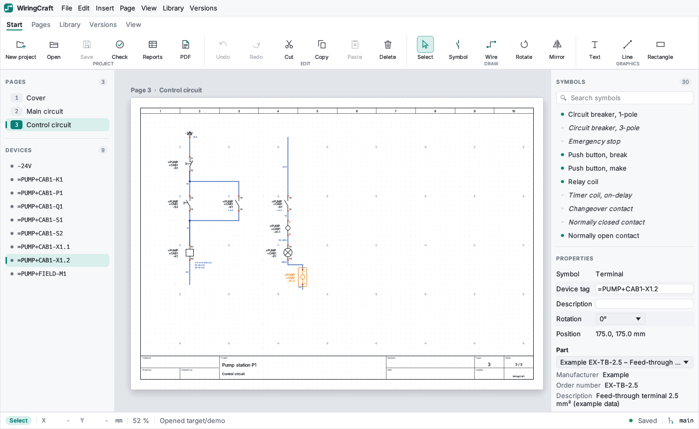

# WiringCraft

An open, original electrical schematic and wiring design tool written in Rust.

WiringCraft covers the familiar workflow of electrical CAD (schematic pages, symbols, device tags,
wires and potentials, terminal strips, cables and reports) and rebuilds the plumbing underneath it:

- **Projects are plain text.** One file per page, sorted keys, written atomically and only when
  changed. Diff, merge and review them in git like code.
- **The library is versioned.** Every symbol and part has a content hash; a project pins the exact
  versions it uses in `library.lock` and keeps a copy in `vendor/`, so it opens offline and never
  changes underneath you. Updates are shown as a before/after list you accept item by item.
- **Everything is scriptable** through the `wiringcraft` command line.

## Status

Phase 1 (foundation) is in progress: project format, library and sync, imports, PDF export.
See the feature list for the full plan.

## Layout

| Crate | Role |
|---|---|
| `wc-core` | data model, device tags (IEC 81346 style), project folder format, connectivity |
| `wc-library` | library sources, lockfile, vendoring, update status |
| `wc-import` | DXF, SVG, CSV, AutomationML, PDF trace, Eplan P8 projects and project archive import |
| `wc-report` | parts list, device list, wire list, net list, terminal plan, cable list |
| `wc-pdf` | vector PDF export (schematic pages plus report pages) |
| `wc-vcs` | git versioning, subway-map history, schematic change lists |
| `wc-cli` | the `wiringcraft` command |
| `wc-app` | the desktop editor (`wiringcraft-app`) |

## Desktop app

```sh
cargo run -p wc-app -- path/to/project
```

Pages on the left, the sheet in the middle, the symbol library and properties on the right.
Commands sit in classic menus and icon toolbars by default; View → Layout switches to a ribbon
(the choice is saved). Both show the same commands from one registry. View → Dark mode (or the
half-moon button at the right end of the toolbar) switches between the light and dark interface;
the sheet stays paper-white in both. The interface font is Inter (SIL Open Font License, bundled
in `crates/wc-app/assets/fonts`).

| Classic toolbars (default) | Ribbon (optional) |
|---|---|
|  |  |


Tools: select and drag (Esc), place symbol (S, pick one in the library), draw wire (W: click a
pin, click bends, click a pin to finish or double-click a free point), rotate (R), delete (Del).
Wheel zooms around the pointer, right or middle drag pans, F fits the page, G toggles the grid.
New devices get the next free tag, with the function and location used on that page.
Versions → Commit / Branch / History records versions and shows the subway map.

## Build

```sh
cargo test --workspace
cargo run -p wc-cli -- --help
```

## Rules

- Original work only: no code, symbols, icons, templates or branding copied from other products.
- No panics on user input: no `unwrap`/`expect`/`panic!` outside tests (enforced by clippy lints).
